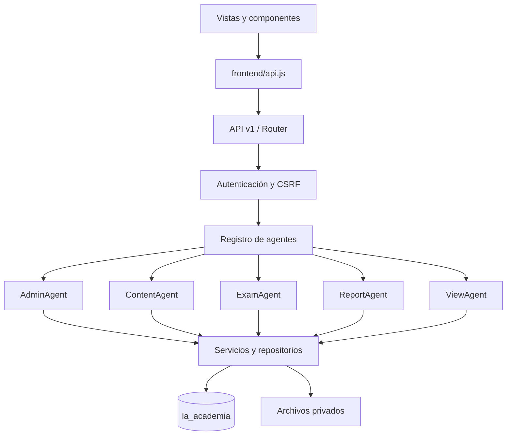

# Arquitectura de La Academia

Actualizado: 23 de octubre de 2026. Alcance: aplicación local, PHP 8.2, MariaDB/MySQL, Apache y JavaScript nativo.

## Decisiones

Se mantiene una aplicación de una sola instalación. No se agregan microservicios, compiladores, contenedores ni frameworks para resolver una plataforma que actualmente tiene poco volumen. La raíz de fuentes contiene `public`, `backend`, `tools`, `tests` y `docs`. Toda la instalación activa está en `C:\xampp\htdocs\la-academia`. La configuración raíz de Apache publica únicamente las rutas de `public/` y deniega acceso directo a `backend/`, `storage/` y demás carpetas internas. No hay copia ni sincronización entre dos instalaciones.

Los agentes son **coordinadores deterministas**, no modelos de lenguaje: reciben una acción conocida, validan el acceso y llaman a servicios. No hay prompts, decisiones autónomas ni llamadas a proveedores de IA. Llamarlos agentes no implica que exista un sistema LLM. Si se añade IA, debe ser un módulo adicional con autorización y evaluación propias.

## Dependencias

## Responsabilidad por carpeta

| Carpeta | Responsabilidad | Qué no debe contener |
|---|---|---|
| `backend/src/Agents` | Coordinar acciones administrativas, contenido, exámenes y reportes | SQL suelto, plantillas HTML o credenciales |
| `backend/src/Services` | Operaciones de negocio, consultas preparadas, validación y tratamiento de archivos | Manipulación de DOM o decisión de navegación |
| `backend/src/Http` | Método/ruta/permisos, contexto y contrato HTTP | Maquetación y reglas del cuestionario |
| `public/frontend/pages` | Componer cada pantalla y conectar sus eventos | Claves de BD o lógica autoritativa de notas |
| `public/frontend/components` | Formularios, galerías, validación, tablas y elementos compartidos | Consultas directas a MySQL |
| `public/assets` | CSS legible y recursos estáticos | Documentos subidos por colaboradores |
| `backend/database` | Definición del esquema | Copias de datos personales |
| `backend/scripts` | Procesos CLI explícitos de instalación y mantenimiento | Endpoints públicos |
| `tests` | Verificar reglas y contrato sin dejar registros funcionales | Contraseñas reales guardadas |
| `docs` | Explicar contratos, alcance, operación y limitaciones | Copias de secretos |

## Agentes

- **AdminAgent**: sesión; actividad automática; eventos; categorías; administración de usuarios y sedes. Las operaciones de usuarios y sedes exigen superadministración.
- **ContentAgent**: catálogo, editor, creación con material, publicación, archivado, descarga y lectura de presentaciones.
- **ExamAgent**: creación/versionado de cuestionarios e intentos del trabajador.
- **ReportAgent**: resumen y resultados protegidos.
- **ViewAgent**: aperturas públicas de contenido; delega en `ContentViews`, con deduplicación por sesión y exclusión de administradores.

`backend/src/Http/AgentRegistry.php` realiza la composición de dependencias. Los repositorios reciben `Database`; los servicios reciben sus colaboradores por constructor. No existe un contenedor global que descubra servicios implícitamente.

## Servicios relevantes

| Archivo | Responsabilidad |
|---|---|
| `ContentViews.php` | Incremento atómico de visitas públicas, sin datos personales ni cambios editoriales |
| `AuthTool.php` | Cookies, identidad vigente, CSRF, login y permisos |
| `UserRepository.php` | Altas/ediciones, hash de contraseña y protección del superadministrador |
| `SiteRepository.php` | Sedes y restricción de desactivación con usuarios activos |
| `CourseCreationTool.php` | Coordinar creación y primer archivo con reversión |
| `CourseRepository.php` | Información, catálogo, condiciones de publicación y archivado |
| `FileTool.php` | Validar/subir/servir archivos y comprobar visibilidad |
| `PresentationTool.php` | Validar y extraer texto de PPT/PPTX; compatibilidad de lectura |
| `SliderImages.php` | Importación inicial de imágenes heredadas del slider |
| `HomeSliderRepository.php` | Listado público ordenado y CRUD del slider administrado |
| `HomePopupRepository.php` | Colección de anuncios y activación exclusiva transaccional |
| `DocumentPreviewTool.php` | Cola de conversión local, portadas JPEG y PDF derivados |
| `ExamRules.php` | Cuestionario válido, proyección pública y nota |
| `AttemptTool.php` | Control de dos intentos, bloqueos y reenvío idempotente |
| `EventGalleryTool.php` | Número, orden y referencias de imágenes |
| `Database.php` | PDO preparado y transacciones; savepoints cuando hay una transacción exterior |

## Estado y frontend

La sesión vive en PHP y se identifica con la cookie `LAACADEMIA`, limitada a `/la-academia/`, HttpOnly y SameSite Strict. El cliente mantiene el CSRF en memoria. `session()` comparte una petición en curso para evitar inicializaciones paralelas.

El router consulta la sesión (reutilizada en memoria hasta 15 segundos) y carga la vista. El encabezado, sidebar y campana permanecen montados entre secciones del panel para la misma identidad; únicamente se sustituye el área de trabajo cuando la nueva vista está lista. Los avisos iniciales se cargan en paralelo con la página cuando es necesario crear la navegación. La campana conserva su sondeo automático; no se reinicia al pulsar cada enlace del sidebar. Un contador evita que una respuesta de una navegación anterior sustituya la pantalla actual. Al navegar se cierran los diálogos. Los formularios muestran errores por campo y conservan sus datos ante un guardado fallido.

`public/frontend/read-cache.js` mantiene hasta 64 respuestas en memoria, comparte peticiones simultáneas y entrega copias independientes. `api.js` establece los tiempos: 30 segundos para listados administrativos de capacitaciones y eventos, 60 para categorías. Las escrituras y subidas invalidan antes y después de ejecutarse, incluidas las que fallan; una petición anterior no puede repoblar una caché invalidada. También se limpia al cambiar la identidad o CSRF y ante errores 401, 403 o CSRF vencido. No utiliza almacenamiento persistente para estas respuestas.

Resultados, exportaciones Excel, resumen, detalles de edición, exámenes, usuarios, sedes y sondeo de notificaciones siguen consultando al servidor. La caché de navegación no reemplaza las validaciones ni los permisos del backend. La prueba `tests/navigation-cache.mjs` verifica estas reglas con HTTP simulado, sin modificar la base de datos.

La API calcula notas, permisos y visibilidad; JavaScript solo presenta esos resultados. Las categorías viven en MySQL. Las marcas de notificación leída se conservan en localStorage por usuario, como identificadores y huellas del contenido; no almacenan el texto ni credenciales y no equivalen a una confirmación centralizada de lectura.

## Persistencia, reglas y entrada pública

Los repositorios residen en `backend/src/Repositories`, los servicios de aplicación en `backend/src/Services`, y las utilidades en `backend/src/Support`. Autoload resuelve namespace y directorio con mayúsculas consistentes. Las migraciones están en `backend/src/Migrations`.

`public/index.php` carga el backend privado y delega a `Http/WebKernel`. Este obtiene la ruta desde la URL, nunca de un parámetro `route` manipulable. `Http/ApiKernel` ejecuta rutas, permisos, CSRF y errores JSON. `backend/routes/api.php` concentra el contrato.

Las vistas PHP se mantienen en `backend/views`: `shell.php` y un único `footer.php` para el portal y el acceso. El footer se oculta en el panel autenticado y reaparece al volver al portal. No quedan plantillas PHP bajo `public/frontend`.

El proyecto activo completo reside en `C:\xampp\htdocs\la-academia`; no requiere sincronizar dos árboles. Las copias anteriores son respaldos privados de recuperación. No se publican scripts, pruebas, documentos, credenciales o respaldos. Apache además rechaza rutas internas y cualquier PHP distinto de `index.php`.

## Registro de actividad — 3 de octubre de 2026

`Repositories/ActivityRepository` registra cambios con la transacción de negocio y produce el feed administrativo. `activity_log` es persistente; `FileCache` solo acelera consultas. Los cierres se materializan al consultar el feed, con clave única por examen/fecha. El cliente compara revisiones y limpia la caché de navegación cuando hay novedades. La pantalla de Resultados escucha esa actualización sin reconstruir sidebar ni campana. Véase [ACTIVIDAD.md](ACTIVIDAD.md) para alcance, tiempos y límites.

## Catálogo público y medios de Inicio — 26 de octubre de 2026

El slider se administra desde superadmin y persiste en `home_slides`. `PortalMediaMigration` importa las imágenes de la carpeta antigua una sola vez; luego el panel controla altas, cambios y bajas. La API pública usa caché invalidada por escrituras; la administrativa se consulta en vivo. `home_popup` es una colección con restricción única sobre el estado activo y un bloqueo transaccional compartido. Las vistas previas reutilizan el marcado del portal. Ver [Slider](SLIDER-INICIO.md) y [Popups](POPUP-INICIO.md).

El filtro público de capacitaciones usa los elementos ya cargados, reinicia la página y cancela la transición anterior si cambia otra vez. La transición modifica solo opacidad y respeta movimiento reducido. Tarjetas y estado vacío reservan la misma altura mínima; el ancho de la barra de desplazamiento se mantiene estable. Estos estilos están delimitados a `.course-catalog` para no modificar el panel ni los eventos.

## Revisión del backend — 28 de octubre de 2026

Se conserva Agents como nombre de los controladores y el contrato v1. CourseAccess/CoursePolicy centralizan autorización por sede; AccessRepository consulta pertenencia con locks para mutaciones. ReportExport separa construcción XLSX de consultas. MediaUpload comparte la carga de slider/popup; Validators contiene reglas comunes de personal y contraseñas. ErrorHandler y Logger normalizan errores y diagnóstico seguro. Database coordina efectos de archivos con commit/rollback de transacciones gestionadas. [Auditoría y mapa completo](AUDITORIA-BACKEND-2026-10-27.md).
