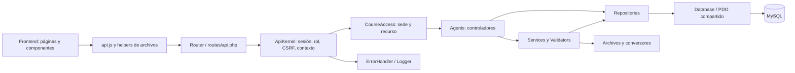

# Auditoría del backend y MySQL — 27 de octubre de 2026
> Estado posterior de B01–B04: [correcciones de gravedad alta y permisos del 28 de octubre](CORRECCIONES-ALTAS-2026-10-28.md). La descripción de PHP 8.2.12/root y B04 pendiente corresponde al estado anterior a esa revisión.


## Alcance y línea base, antes de modificar código

Instalación activa: `C:\xampp\htdocs\la-academia`. Se leyeron los 65 PHP activos (169 409 bytes), las 71 rutas, los clientes HTTP, el esquema base y las once migraciones. Se inspeccionaron metadatos de las 19 tablas con una transacción MySQL de solo lectura. No se consultaron contraseñas, tokens ni filas de personal para el informe. Las copias de `storage/backups` y `archive` son historia, no una segunda aplicación.

El entorno real es PHP 8.2.12 y **MySQL 8.0.46**, con InnoDB y modo estricto. La documentación anterior que identifica MariaDB 10.4.32 no describe la conexión actual. La cuenta de aplicación tiene privilegios root y contraseña configurada; no se reproduce su valor. La configuración reside en `storage/config.php`, protegida por Apache. La publicación está limitada a `Require local`.

No hay archivos PHP activos idénticos. La duplicación es de responsabilidades: cargas de slider/popup, validaciones del padrón en CLI/repositorio, consultas de última entrega y orquestación de conversores. Los PHP tienen pocas líneas pero muy largas (hasta 1 104 caracteres); el número de líneas no representa su complejidad.

## Hallazgos iniciales priorizados

| ID | Gravedad | Evidencia inicial | Riesgo y corrección prevista |
|---|---|---|---|
| B01 | Alta | CourseRepository::save verifica sede; ContentAgent, ExamAgent y ReportAgent permiten otras acciones a cualquier cuenta activa | IDOR entre sedes en borradores, exámenes, resultados y cambios. Aplicar la regla documentada en PROCESOS a todos los accesos administrativos; mantener catálogo público. |
| B02 | Alta | DocumentPreviewTool::work devuelve mensajes de RuntimeException; PDOException hereda RuntimeException | Un fallo SQL puede terminar en error_message y llegar al público. Mensajes públicos permitidos explícitamente y logging técnico separado. |
| B03 | Alta | PHP 8.2.12 y usuario MySQL root | Actualizar runtime y configurar cuenta de mínimo privilegio requiere mantenimiento del entorno. No cambiar credenciales ni instalar servicios dentro de esta refactorización. |
| B04 | Alta, funcional | AttemptTool usa solo DNI, devuelve identidad y reemplaza pendiente al reiniciar | El DNI identifica un registro pero no acredita al participante; enumeración y suplantación posibles. Requiere una decisión de identidad/invitación y límites que preserve el flujo esperado. |
| B05 | Media | tests/run.php usa configuración activa y modifica tablas dentro de rollback; personnel-import.php usa Excel real | Rollback no aísla locks, secuencias ni efectos en disco. Crear base y almacenamiento de prueba separados con datos sintéticos. |
| B06 | Media | ReportRepository::summary ejecuta una consulta top-3 por curso | N+1 medible (N+4 consultas). Centralizar la consulta y comparar resultados/planes antes de optimizar. |
| B07 | Media | AttemptTool inicia bloqueando curso→matrícula y envía bloqueando matrícula→join curso | Orden inverso de locks puede provocar deadlocks; unificar orden y probar concurrencia en base aislada. |
| B08 | Media | FileTool::remove puede poner un curso archivado en draft; cover no bloquea con remove | Transiciones incoherentes y referencia de portada obsoleta. Mantener archivo y portada bajo el lock del curso. |
| B09 | Media | PersonnelRepository valida sedes antes de la transacción y actualiza todas las matrículas | Carreras con desactivación, cambios de datos históricos no acotados y accesos desalineados. No corregir registros reales automáticamente. |
| B10 | Media | API captura excepciones pero solo registra las no previstas; no hay niveles ni módulo estable | Normalizar log seguro correlacionado y registrar fallos críticos, sin cuerpos ni mensajes SQL. |
| B11 | Media | schema.sql no representa el esquema final; índices de OrganizationMigration dependen de añadir columnas | Una instalación nueva puede carecer de uq_admin_dni/idx_course_site/idx_employee_site. No ejecutar migraciones; preparar propuesta revisable. |
| B12 | Media | Repositorios contienen validación, reglas y SQL; AdminAgent agrupa varios módulos | Separación parcial por capas, acoplamiento a Http y construcción de colaboradores dentro de métodos. Extraer responsabilidades cuando tengan contrato y pruebas. |
| B13 | Baja/Media | Listados completos, SELECT *, exportación en memoria, caché bloqueante | Medir antes de paginar o introducir infraestructura. Cambiar paginación alteraría el contrato del frontend. |
| B14 | Baja | API.md exige diez preguntas y luego admite cantidad flexible | Documentación contradictoria; el contrato vigente admite una o más preguntas y nota proporcional. |

## Integridad observada

Las consultas agregadas iniciales detectaron 0 portadas inexistentes/ajenas, 0 notas fuera de 0–20, 0 matrículas con varios intentos pendientes y 0 popups activos adicionales. Detectaron **1 acceso capacitador activo sin correspondencia consistente con el padrón/sede**. No se identificó a la persona ni se modificó su cuenta. Estos controles no equivalen a comprobar toda la base.

## Decisión arquitectónica

Conservar el monolito modular por funcionalidades con capas: `routes` → `Agents` (controladores existentes) → `Services` → `Repositories` → PDO/MySQL. `Http` contiene enrutamiento, contexto, excepciones y respuesta. Agregar middleware, validadores y soporte compartido solo para responsabilidades reales. No se necesita framework, ORM, contenedor de dependencias, JWT, microservicios ni Composer mientras no haya dependencias PHP externas. No crear Models/Entities vacíos: los arrays del contrato son suficientes actualmente.

Las vistas PHP solo generan shell/footer y escapan su contenido; no contienen consultas SQL ni operaciones de negocio. La deuda principal está en servicios/repositorios, no en mezclar SQL con HTML.

## Referencias de seguridad

La revisión contrasta los accesos por recurso con [OWASP Authorization](https://cheatsheetseries.owasp.org/cheatsheets/Authorization_Cheat_Sheet.html) y la separación de información pública/técnica con [OWASP Logging](https://cheatsheetseries.owasp.org/cheatsheets/Logging_Cheat_Sheet.html). Se requiere validación de permisos en cada solicitud, denegación por defecto y exclusión de secretos de los logs.

La versión instalada debe contrastarse con [versiones soportadas de PHP](https://www.php.net/supported-versions.php). Una rama soportada no implica que un parche antiguo esté actualizado.

## Resultado y evidencias — cierre 28 de octubre de 2026

Se implementó una refactorización incremental sobre la instalación activa. Se conservaron las 71 rutas, los métodos HTTP y el envoltorio JSON. Los cambios deliberados de comportamiento son el rechazo de accesos entre sedes, la protección de importaciones incompatibles con accesos activos, las correcciones de estado/concurrencia y mensajes seguros de error. No se ejecutaron migraciones ni reparaciones de datos reales. Las escrituras de prueba se hicieron en bases temporales independientes, con filas sintéticas.

Entregables reproducibles:

- 71 endpoints: propósito, entrada, permisos, respuesta, errores y consumidores (evidencia local excluida de Git), con versión JSON (evidencia local excluida de Git).
- 76 archivos PHP activos y sus métodos (evidencia local excluida de Git), inventario estático (evidencia local excluida de Git) y dependencias de clases (evidencia local excluida de Git).
- Metadatos MySQL, integridad agregada y EXPLAIN (evidencia local excluida de Git). No contiene filas de personas, respuestas de exámenes ni credenciales.
- Salida de la verificación completa (evidencia local excluida de Git), auditoría npm (evidencia local excluida de Git) y cambios de código contra el respaldo inicial (evidencia local excluida de Git), con lista de archivos y hashes (evidencia local excluida de Git).
- Propuesta de índices y procedimiento de respaldo/reversión (evidencia local excluida de Git). Es una propuesta pendiente, no un cambio aplicado.

### Estado de hallazgos y riesgo de modificación

| ID | Estado final | Cambio / pendiente | Riesgo de modificar y verificación |
|---|---|---|---|
| B01 | Corregido en las rutas de cursos | CoursePolicy, CourseAccess y AccessRepository validan sede; listados, reportes y campana filtran en SQL; caché de campana incluye sede | Alto: cambia el alcance administrativo para cumplir PROCESOS. Pruebas de dos sedes, superadmin, archivos, resultados y caché. Eventos mantienen su alcance compartido. |
| B02 | Corregido | PreviewException permite solo mensajes conocidos; también sanea errores históricos al leer. ErrorHandler separa respuesta y diagnóstico | Medio: se pierde el texto técnico público de conversión. Se conserva request_id y diagnóstico sin SQL/secretos. |
| B03 | Pendiente de mantenimiento | PHP 8.2.12 y conexión root siguen instalados | Alto: actualizar XAMPP/PHP puede afectar otras aplicaciones. Se necesita copia del entorno, prueba de extensiones/conversores y cuenta SQL propia. No se cambiaron credenciales. |
| B04 | Pendiente de decisión funcional | El flujo público continúa usando DNI e intento con token | Alto: exigir invitación u otra prueba de identidad afecta al participante y al frontend. Conocer un DNI sigue permitiendo consultar identidad e iniciar/reemplazar un pendiente. |
| B05 | Corregido para la suite mantenida | Runner con base, archivos, sesiones, caché y servidor HTTP temporales; una base distinta por suite | Bajo para la aplicación; el usuario de pruebas necesita CREATE/DROP DATABASE. Los scripts HTTP rechazan destinos que no sean loopback aislado. |
| B06 | Corregido | Resumen pasa de N+4 a tres consultas con resultados; dos si no hay notas | Medio: conserva última entrega completada por matrícula, top-3, empates y tipos numéricos; probado con cuatro cursos y datos sintéticos. |
| B07 | Corregido el orden identificado | Inicio/envío toman curso → matrícula → intento | Alto por concurrencia: 20 pares de procesos para inicio/envío y doble envío. No es una demostración de ausencia de todos los deadlocks posibles. |
| B08 | Corregido | Borrar último material solo devuelve published a draft; portada y eliminación coordinan bloqueo; disco se elimina después del commit | Alto por combinación SQL/disco; pruebas de estados, archivos HTTP y compensación. Fallos de limpieza se registran y pueden dejar un huérfano recuperable. |
| B09 | Corregido preventivamente | Validación común, sedes bloqueadas y cuentas revalidadas; sincronización acotada a DNIs importados. CLI de reemplazo rechaza excluir capacitadores activos | Medio/alto: un lote incompatible ahora falla con 409 sin cambios. La inconsistencia existente permanece pendiente; no se eligió una sede ni se desactivó una persona. |
| B10 | Implementado | ErrorHandler y Logger con info/warning/error, módulo, ruta plantilla, request_id y código del driver | Medio: revisar retención/rotación operativa de logs. No es un registro forense inmutable. |
| B11 | Documentado y propuesto | Los tres índices existen en la base instalada. La secuencia de instalación sigue requiriendo revisión | Alto en instalaciones nuevas: propuesta aditiva, preflight, respaldo y reversión sin ejecutar. schema.sql y las once migraciones no se reescribieron automáticamente. |
| B12 | Mejorado; deuda explícita | Exportación fuera del repositorio; carga de imágenes compartida; validadores; autorización; composición en AgentRegistry | Medio: repositorios aún contienen reglas y algunos servicios SQL. No se afirma una separación total de dominio/persistencia. Extraer todo ahora ampliaría el riesgo sin evidencia adicional. |
| B13 | Pendiente medido | Se eliminó N+1 del resumen; se conservan límites/contratos del resto | Bajo/medio: paginar cambia consumidores; exportación y conversiones necesitan medición con volumen representativo. |
| B14 | Corregido | API.md e inventario reflejan cantidad variable de preguntas y sede | Bajo: documentación contrastada con rutas y pruebas. |
| B15 | Corregido | PostCSS de desarrollo 8.5.6 → 8.5.32 en package/lock | Bajo: npm audit informa cero vulnerabilidades conocidas y pasan diseño/DOM. No añade dependencia de producción. |
| B16 | Corregido | Setup y gestión de accesos comparten Password: conserva espacios, limita bytes bcrypt y rechaza NUL | Medio: no cambia hashes existentes. Pruebas de autenticación y validación. |

### Estructura, responsables y composición

```text
index.php → public/index.php
backend/
  bootstrap.php                 autoload Academia\\, zona horaria, errores
  config/application.php        defaults + entorno + configuración privada
  routes/api.php                71 definiciones declarativas
  views/{shell,footer}.php       presentación escapada
  database/schema.sql           esquema base histórico
  scripts/                      migración, importador CLI, previews, huérfanos, auditoría
  src/
    Http/                       WebKernel, ApiKernel, Router, contexto, registro, errores
    Agents/                     controladores existentes
    Middleware/                 CourseAccess
    Validators/                 PersonnelRows, Password
    Services/                   reglas, archivos, intentos, conversión, exportación
    Repositories/               consultas y persistencia por módulo
    Support/                    PDO, Http, caché, logs, ZIP/XLSX/PPT
    Exceptions/                 PreviewException
    Migrations/                 once migraciones históricas
public/frontend/                API, páginas, componentes y estado del navegador
storage/                        configuración privada, archivos, previews, caché, respaldos
tests/ y tools/                 pruebas, generación/verificación y runtime de conversión
```

Los 76 PHP activos del inventario incluyen `public/index.php`; el wrapper raíz `index.php` solo lo incluye. No se tratan como código activo las copias de respaldo/archivo ni bibliotecas ejecutables de terceros. El autoloader pequeño ya corresponde al namespace y a una clase por archivo; Composer no aporta valor sin paquetes PHP externos. Se conservan los nombres Agents por compatibilidad interna: cumplen la función de Controllers.

| Módulo | Controlador y consumidor principal | Servicio/regla y datos |
|---|---|---|
| Sesión/accesos | AdminAgent; login, sesión, admin-users | AuthTool y Password; UserRepository; admins, auth_attempts |
| Organización/padrón | AdminAgent; admin-sites, admin-personnel | PersonnelImportTool, PersonnelRows; SiteRepository, PersonnelRepository; sites, employees |
| Capacitaciones | ContentAgent; catálogo, curso, admin-courses | CourseCreationTool, CoursePolicy, FileTool; CourseRepository, CategoryRepository; courses, categories, files |
| Evaluación | ExamAgent; evaluation-dialog, admin-exam | ExamRules, ExamSchedule, AttemptTool; ExamRepository; exams, enrollments, attempts |
| Reportes | ReportAgent; admin-home, admin-reports | ReportExport/XlsxWriter; ReportRepository; cursos, versiones, matrículas e intentos |
| Eventos | AdminAgent; eventos, galería, admin-events | EventGalleryTool/FileTool; EventRepository; events, event_images, files |
| Popup/slider | HomePopupAgent/HomeSliderAgent; inicio y editores | MediaUpload; HomePopupRepository/HomeSliderRepository; home_popup, home_popup_guard, home_slides |
| Visitas/actividad | ViewAgent/AdminAgent; content-views y campana | ContentViews; ActivityRepository; contadores de cursos/eventos y activity_log |
| Derivados | ContentAgent y preview-worker.php; course-cover/material-viewer | DocumentPreviewTool, PresentationTool, Poppler/LibreOffice; files, file_previews |
| Infraestructura | WebKernel → ApiKernel → AgentRegistry | Database, Http, FileCache, Logger, ErrorHandler; una conexión PDO por solicitud |



El diagrama muestra la implementación actual, incluidos los controladores que llaman directamente a repositorios. Repositorios y servicios aún usan Http::fail; ese acoplamiento queda localizado y probado. Se eliminó el ciclo AuthTool → WebKernel → ApiKernel → AuthTool moviendo la normalización de ruta a Support/Http; WebKernel conserva un adaptador para llamadas existentes. El grafo estático final no detecta ciclos entre clases conocidas; incluye imports, referencias completas y llamadas locales, pero no sustituye un perfil de ejecución ni descubre referencias construidas dinámicamente.

Convenciones: `declare(strict_types=1)`, namespace `Academia\<capa>`, clase/archivo PascalCase, métodos camelCase, SQL parametrizado, IDs como enteros validados, rutas snake_case existentes conservadas. Las nuevas responsabilidades tienen uso real; no se añadieron directorios vacíos de Entities/Models. Cambios de nombres/formato masivos se aplazan para que la revisión funcional sea legible.

### Reglas funcionales y efectos secundarios

| Regla | Ubicación identificada | Efecto/límite |
|---|---|---|
| Sesión válida, expiración, roles, CSRF | AuthTool; acceso declarativo en routes y ApiKernel | Consulta estado/auth_version del usuario; regenera ID y CSRF; el sondeo de campana no prolonga sesión |
| Capacitador solo administra su sede | CoursePolicy + CourseAccess; filtros de repositorios | Recursos publicados permanecen públicos; eventos siguen compartidos; superadmin conserva alcance total |
| No eliminar último superadmin ni degradar el acceso propio | UserRepository::save | Bloquea conjunto de administradores; cambio de contraseña/desactivación invalida sesiones |
| Sede activa y colaborador compatible | SiteRepository, PersonnelRepository, UserRepository | Orden sedes → cuentas → colaboradores; validación léxica en PersonnelRows, regla relacional dentro de transacción |
| Importación por lote / reemplazo completo | PersonnelRepository::importRows / replaceRows | Panel mantiene ausentes; CLI desactiva ausentes y conserva sede existente. Ambos sincronizan nombres/cargos de matrículas importadas; las notas no se recalculan |
| Contraseñas | Password; hash/verify en AuthTool/UserRepository | ≥12 caracteres, ≤72 bytes; sin recortar espacios; no se migran hashes históricos |
| Publicación/archivo/portadas | CourseRepository + FileTool | Publicar exige material y, si corresponde, examen; archivado conserva historia; quitar último material no revive archivados |
| Preguntas/versionado/periodo | ExamRules, ExamSchedule, ExamRepository | Cambiar preguntas crea versión; solo cambiar horario conserva versión; sin examen oculta evaluación pública |
| Intentos/nota/plazo | AttemptTool + ExamRules/ExamSchedule | Máximo configurado de dos entregas; reinicio reemplaza pendiente; nota proporcional sobre 20; reenvío completado devuelve resultado original |
| Última entrega/reportes | ReportRepository; exportación en ReportExport | Última completada por matrícula, no máximo puntaje. Cuenta evaluaciones incluye historia, incluso cursos archivados, como antes |
| Galería, enlaces, exclusividad | EventGalleryTool, HomePopupRepository, HomeSliderRepository | Galería de 3–12 imágenes al publicar; enlaces validados; guard y restricción única coordinan popup activo |
| Visitas/actividad | ContentViews + ActivityRepository | Apertura contada una vez por sesión; claves evitan eventos duplicados; consulta de campana puede insertar cierres |
| Archivos/derivados | FileTool, MediaUpload, DocumentPreviewTool | Carga puede crear archivo y fila; rollback compensa carga, commit habilita borrado; worker genera derivados fuera de la petición |

Transacciones Database usan savepoints cuando anidan. Las acciones de filesystem se propagan al commit/rollback gestionado más externo. Un commit SQL no hace atómico al disco: si su limpieza falla se registra un error y puede quedar un archivo huérfano. No se promete compensación frente a terminación abrupta del proceso. Las transacciones PDO iniciadas manualmente fuera de Database no ejecutan callbacks de commit; solo las pruebas históricas usan esa modalidad con limpieza del temporal. El código de aplicación debe utilizar Database::transaction.

No se encontró SQL en shell/footer. Las funciones con más responsabilidades siguen siendo UserRepository::save, CourseRepository::save, ExamRepository::save, AttemptTool y DocumentPreviewTool; combinan reglas/transacciones o ejecutables externos, por lo que requieren caracterización antes de otra extracción. AdminAgent agrupa varios módulos pequeños. El inventario incluye bytes, líneas, métodos y longitud máxima para no confundir código compactado con simplicidad.

### Base de datos e integridad

Metadatos observados: **19 tablas InnoDB, 142 columnas, 53 índices y 18 claves foráneas**. Los detalles exactos de tipos, nulabilidad, claves e índices están en mysql-metadata.json; sus planes no contienen valores de participantes. Predominan IDs BIGINT UNSIGNED, DNI CHAR(8), claves únicas, ENUM para estados y fechas DATETIME. JSON de examen/respuestas se valida en aplicación; el esquema no expresa todas las reglas de dominio. Las tablas nuevas de medios usan collation distinta de parte del esquema base (`utf8mb4_unicode_ci` frente a `utf8mb4_0900_ai_ci`); no se cambió esa configuración.

| Grupo | Tablas | Relaciones y límites |
|---|---|---|
| Organización | sites, employees, admins, auth_attempts | employees por DNI; admins referencia colaborador/sede; auth_attempts registra hash de IP y fecha. La coincidencia entre sedes de acceso/padrón necesita regla de aplicación |
| Aprendizaje | categories, courses, files, exams, enrollments, attempts | curso → versiones; versión + DNI único; matrícula → intentos; token_hash único; curso → archivos. Categoría se guarda por nombre validado, sin FK a categories |
| Publicación | events, event_images, announcements, home_popup, home_popup_guard, home_slides | Galería une evento/archivo, posición y archivo únicos por evento; popup permite un active_slot; guard serializa activación. announcements se conserva por compatibilidad histórica |
| Operación | activity_log, file_previews, portal_media_migrations | Eventos con event_key único; preview por file_id; marcador de migración de medios. Referencias polimórficas de actividad no son todas FKs y pueden sobrevivir al recurso |

Se ejecutaron controles agregados de todas las FKs, portadas ajenas/inexistentes, notas fuera de rango, JSON inválido, completados incompletos, varios pendientes por matrícula y publicaciones incompletas. Todos resultaron cero salvo **una cuenta capacitadora activa con padrón/sede incompatible**. La exclusividad de popup también fue comprobada durante el análisis inicial y en pruebas aisladas. No se extrajeron identidades ni se realizó reparación. Revisar ese acceso requiere un responsable de datos que decida cuál es el vínculo correcto.

No hay modificación de columnas/relaciones ni nuevos índices aplicados. `OrganizationMigration` agrega ciertos índices solo cuando falta su columna: el esquema base ya puede contenerla, por lo que una instalación nueva puede omitir el índice. Los índices `uq_admin_dni`, `idx_course_site` e `idx_employee_site` sí están presentes en la instalación auditada. La propuesta separa esta reparación de una normalización completa del esquema; no cambia ni ejecuta las once migraciones históricas.

### SQL y rendimiento

Database mantiene una única PDO en la composición de cada solicitud, excepciones habilitadas, prepared statements nativos, charset utf8mb4 y zona SQL -05:00. Los procesos worker tienen su propia conexión, necesaria por aislamiento de proceso. Valores entrantes usan parámetros; identificadores de migración/health provienen de listas internas. LIMIT concatenado está tipado en código. No se identificó interpolación de valores HTTP en SQL durante la revisión.

El resumen usaba cuatro consultas fijas y un top-3 por curso. Ahora comparte la selección de última entrega completada, calcula agregados en SQL y obtiene top-3 con ROW_NUMBER en otra consulta; una tercera reúne contadores. La prueba con cuatro cursos confirma tres ejecuciones preparadas y resultados de referencia. Con los datos locales pequeños, la medición inicial fue 5 consultas/~4,313 ms y una muestra final 3/~2,553 ms; **no es una prueba de carga ni evidencia estadística de reducción de latencia**. La mejora demostrada es eliminar crecimiento lineal de viajes a MySQL.

EXPLAIN muestra uso de claves primarias/uq_exam_version/idx_enrollment_status y tablas derivadas; agrupación/ventana aún pueden usar temporary/filesort. No se agregó un índice especulativo. Antes de optimizar más, medir p50/p95, filas examinadas, memoria de exportación y conversión con una base sintética de volumen representativo.

Otros costes: consultas correlacionadas en listados/resultados; validación/existencia y upsert por fila de importación; materialización de exportación XLSX; parsing de PPT/PDF; bloqueo de sesión PHP y del caché. SELECT * permanece en proyecciones de curso y lecturas internas: retirarlo puede alterar claves del contrato. Los listados no tienen paginación de servidor, resultados visibles tienen límite 1000 y exportación completa no. No se añadió infraestructura de caché, colas, microservicios ni conexiones adicionales. Se reutilizó el caché existente y el worker de previews; la importación XLSX sigue siendo síncrona y su coste debe medirse.

### Seguridad: cobertura y límites

| Vector | Evidencia/control revisado | Estado o limitación |
|---|---|---|
| SQL injection | PDO sin emulación; valores parametrizados; identificadores internos | Sin hallazgo confirmado; esto no equivale a pentest completo |
| XSS | Escape en vistas y consumidores JS; CSP, URLs del popup validadas; exportación trata celdas como texto | Pruebas DOM y XLSX; sin nueva campaña de fuzzing o revisión visual manual autenticada |
| CSRF/CORS | Token de sesión para escrituras, SameSite Strict; no CORS permisivo | Pruebas de token ausente/vencido; GET campana/preview tienen efectos operativos documentados |
| Autenticación | password_hash/verify, setup solo local y base sin usuarios, bloqueo de intentos | DNI del participante sigue sin ser autenticación; excepción de login ilimitado local habilitada |
| Sesión | strict_mode, regeneración login/logout/caducidad, HttpOnly, Secure cuando HTTPS, auth_version | HTTP local no cifra cookie; publicar requiere HTTPS y revisión de proxy/entorno |
| Autorización/IDOR | Rol en cada ruta; sede en recurso y consultas; comprobación antes de binarios/ETag | Corregidos accesos entre sedes; imágenes de eventos compartidas por ausencia de propiedad |
| Escalada | Superadmin obligatorio en usuarios/sedes/padrón/popup/slider; actor desde sesión | Pruebas negativas por rol; una inconsistencia histórica de cuenta pendiente |
| Archivos | MIME/extensión/tamaño/dimensiones, almacenamiento aleatorio privado, autorización de originales/derivados | No hay antivirus/sandbox de conversores; actualizar ejecutables es tarea operativa |
| Traversal/inclusión | Rutas de disco construidas desde registros internos, storage protegido, autoload de clases internas | Apache bloqueó 14 rutas privadas, incluidas codificadas; no se aceptan includes del cliente |
| Errores/logs | Bootstrap sin display_errors; ErrorHandler; Logger excluye cuerpos, tokens, contraseñas y mensajes SQL | Rotación/retención y acceso al log pendientes de operación; logs no garantizan auditoría inmutable |
| Límites | JSON 1 MB, material 50 MB, imágenes 8 MB/8000 px, login limitado salvo loopback, intentos configurados | Consulta pública por DNI no tiene límite independiente; listas/exportación pueden crecer |
| Dependencias/configuración | npm audit final 0; root SQL y PHP antiguo detectados; Apache Require local | npm audit solo cubre dependencias npm conocidas; no certifica PHP, Apache, MySQL o conversores |

La configuración privada permanece fuera de rutas públicas. No se copiaron secretos al respaldo de código, al diff ni a los informes. Los diagnósticos incluyen clase/código/archivo base/línea, nunca el mensaje original de PDO ni parámetros. `actor_id` permite correlación administrativa sin nombre/DNI; debe mantenerse con acceso restringido.

PHP 8.2.12 está muy por detrás de los parches de seguridad de su rama. Consultar el [historial oficial](https://www.php.net/ChangeLog-8.php) y [soporte de PHP](https://www.php.net/supported-versions.php) antes del mantenimiento; el soporte de seguridad de 8.2 termina el 31 de diciembre de 2026. Los avisos oficiales [GHSA-w8hw-w9fx-j79w](https://github.com/php/php-src/security/advisories/GHSA-w8hw-w9fx-j79w) y [GHSA-6wmf-4rv5-p3rp](https://github.com/php/php-src/security/advisories/GHSA-6wmf-4rv5-p3rp) justifican priorizar la actualización, sin afirmar explotabilidad de cada aviso en esta configuración. PostCSS se actualizó también según su [aviso oficial](https://github.com/postcss/postcss/security/advisories/GHSA-fxqj-rqcc-2cmp).

### Contratos y dependencias indirectas

La referencia completa por endpoint está en ENDPOINTS.md. Se mantuvo `{data,meta}` / `{error,meta}` y los binarios independientes; no se creó un segundo wrapper. Los identificadores de ruta prevalecen sobre cuerpos, las creaciones rechazan id recibido y se preservan códigos 401/403/404/409/422 y 410 heredado. La respuesta 5xx se hizo genérica deliberadamente. Los alias y endpoints aparentemente no consumidos no se borraron: no hay prueba de ausencia de clientes externos.

Dependencias indirectas comprobadas: helpers de `api.js` para URL de archivo/exportación; imágenes y visor consumen binarios fuera del fetch JSON; CSS/diseño generan recursos; `preview.status` puede despertar el worker; actividad inserta cierres al leer; CLI de importación y migración no pasan por controladores; carpetas de slider suministran imágenes heredadas; navegación/URL de examen se comparte con campana y reportes. Retirar anuncios históricos, columnas duration/phone/area o archivos aparentemente huérfanos necesita una revisión propia. `orphan-report.php` informa candidatos: no los elimina.

No hay archivos PHP activos idénticos. Las coincidencias SQL del inventario son candidatas, no una orden de fusionar consultas: algunas son comprobaciones intencionales antes y dentro del bloqueo. Se centralizaron carga de medios, validación del padrón, contraseñas, autorización, estadísticas y sincronización de matrículas. Las rutas retiradas con 410 y migraciones históricas son código de compatibilidad, no borrado automático.

### Pruebas, reproducción y reversión

Antes de refactorizar se ejecutó la suite existente en el entorno aislado y se añadieron escenarios de caracterización para estadísticas, idempotencia y estados. La verificación final está en validacion.txt:

- 355 comprobaciones PHP de reglas/CRUD/integración.
- 50 regresiones de sedes, archivos, reportes, errores/logs, contraseñas e importación por lote/reemplazo.
- CSV válido/inválido/multilínea y XLSX sintético convertido con LibreOffice.
- 45 comprobaciones concurrentes: 25 pares de procesos, incluyendo doble envío, inicio frente a envío y popup exclusivo.
- 107 contratos HTTP y 21 pruebas HTTP de medios con cargas reales sintéticas.
- Exportación XLSX de 1200 filas; protección Apache: 14 privados bloqueados y dos entradas públicas operativas.
- Suites existentes JS/DOM/diseño/caché, sintaxis PHP/JS e imports/enlaces. No se atribuye cobertura porcentual sin instrumentación.

Desde la raíz activa, `powershell -File tools/check-local.ps1` ejecuta la batería mantenida. `php tests/isolated.php backend-regression.php` permite una regresión acotada. El runner copia exclusivamente definiciones de tablas, crea `academia_test_<16 hex>`, siembra fixtures y elimina solo su base/temporal verificados. No ejecutar directamente pruebas históricas contra la configuración activa; los entrypoints mantenidos lo rechazan. `php backend/scripts/audit.php` usa transacción READ ONLY; `python tools/audit-backend.py` regenera inventarios sin acceso a datos.

La copia previa está en `C:\xampp\htdocs\la-academia\storage\backups\backend-audit-20261027-40a12a22`. No es un dump de información real. El directorio activo no es un checkout Git; cambios.patch facilita la revisión. Para revertir código: detener escrituras/worker durante la ventana, conservar cambios posteriores, restaurar solo archivos modificados desde esa copia y retirar los archivos nuevos enumerados por el diff después de revisar sus consumidores. Restaurar package.json/lock juntos y usar `npm ci --ignore-scripts` en tests. No restaurar almacenamiento ni ejecutar migraciones; esta intervención no alteró el esquema real. Repetir pruebas aisladas y health después de restaurar.

Prioridades pendientes: mantenimiento de PHP y mínimo privilegio SQL; decisión sobre identidad del participante; revisión privada de la cuenta inconsistente; instalación reproducible del esquema y propuesta de índices; después, medición de paginación/exportación/importaciones con volumen representativo. Son límites explícitos de esta entrega y no se presentan como problemas solucionados.
