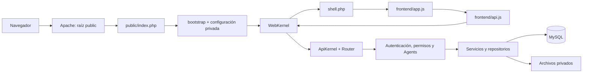

# La Academia · Documentación técnica

**Versión documental:** 1.0 · **Fecha:** 29 de octubre de 2026, America/Lima.
**Código revisado:** `C:\xampp\htdocs\la-academia`.
**Destinatarios:** desarrollo, soporte, administración del servidor y responsables de capacitación.

Este documento describe la implementación actual. Las propuestas de despliegue y separación por dominio se identifican expresamente como tales. Los ejemplos usan nombres ficticios y no contienen contraseñas ni datos de trabajadores.

## Guía de lectura

| Necesidad | Documento |
|---|---|
| Entender el sistema, sus datos y configuración | Este documento |
| Identificar qué hace cada archivo de código | [Mapa de archivos](MAPA-ARCHIVOS.md) |
| Publicar una sede y repetir el despliegue por subdominio | [Hosting y subdominios](DESPLIEGUE-Y-SUBDOMINIOS.md) |
| Comprobar el punto de entrada y Apache | [Arranque y raíz pública](ARRANQUE-Y-HOSTING.md) |
| Consultar contratos HTTP | [API](API.md); la autoridad es `backend/routes/api.php` |
| Cambiar estilos y componentes | [Sistema de diseño](DISENO.md) |

## 1. Qué contiene y qué resuelve

La Academia es una aplicación de capacitación con catálogo público y panel administrativo. Un mismo proyecto contiene el frontend, la API PHP y la lógica de negocio. MySQL conserva los registros; el almacenamiento privado conserva los archivos.

| Módulo | Comportamiento actual |
|---|---|
| Portal | Inicio, carrusel, popup activo, catálogo de capacitaciones y eventos |
| Capacitaciones | Material PDF/PPT/PPTX, portada, borrador, publicación y archivado |
| Evaluaciones | Preguntas versionadas, apertura/cierre, duración, identificación previa por DNI, intentos y calificación sobre 20 |
| Resultados | Participantes por versión de examen, estados de entrega y exportación XLSX |
| Inicio administrativo | Vistas, promedios y participación; comparación de cinco elementos por página, detalle lateral y Top 3/5/10 |
| Colaboradores | Buscar, crear, editar, desactivar y reactivar; validación y confirmación de carga CSV/XLSX |
| Usuarios | Accesos de capacitador y superadmin, contraseñas, estado y sede |
| Sedes | Registro de sedes y asociación con trabajadores, capacitadores y capacitaciones |
| Eventos y medios | Publicaciones con galería, administración del carrusel y de popups |
| Actividad | Campana con resultados, cambios, cierres e hitos de vistas |

La gestión manual de avisos está retirada de la interfaz; subsisten rutas/tablas de compatibilidad. Los objetos llamados `Agents` son controladores deterministas que coordinan servicios: no son agentes de IA ni llaman a modelos externos.

### Límites funcionales que afectan al despliegue

- El catálogo publicado es público. El filtro administrativo por sede no convierte el catálogo en un portal privado de esa sede.
- No existe todavía una resolución de `subdominio → sede` en el backend.
- Eventos, carrusel y popup no tienen aislamiento general por sede dentro de una base compartida.
- Las vistas son contadores anónimos por publicación y sesión. No equivalen a trabajadores identificados ni demuestran lectura completa.
- El DNI se solicita antes del examen. No autentica por sí solo a la persona ni identifica las aperturas previas del material.
- Varias instalaciones pueden usar la misma versión del código con bases y almacenamiento independientes. Esto separa los datos entre portales, pero no impide por sí mismo que alguien visite otro portal.

La guía de [subdominios](DESPLIEGUE-Y-SUBDOMINIOS.md) desarrolla las dos opciones y el trabajo adicional para exigir pertenencia del trabajador antes de contar una lectura.

## 2. Tecnología y entorno comprobado

| Componente | Evidencia local | Implicación para hosting |
|---|---|---|
| PHP | CLI 8.2.35; Apache usa el módulo PHP de XAMPP | Probar una rama mantenida y sus extensiones; no copiar binarios Windows a Linux |
| Apache | 2.4.58 Win64 | Requiere reglas de reescritura y ejecución de PHP; usar una versión actualizada del proveedor |
| Servidor de base de datos | `SELECT VERSION()` devolvió **MySQL 8.0.46** | Esta es la referencia real de compatibilidad |
| Cliente SQL de XAMPP | Se identifica como MariaDB 10.4.32 | La versión del cliente no identifica el motor conectado; usar herramientas de copia compatibles con MySQL |
| Base activa | `la_academia`, 19 tablas; collation de la base `utf8mb4_unicode_ci` | Verificar también las collations de las tablas al restaurar |
| Frontend | JavaScript nativo con módulos ES; HTML y CSS | No necesita un servidor Node en producción |
| Dependencias de desarrollo | jsdom 26.1.0, PostCSS 8.5.32; openpyxl 3.1.5 para pruebas | Instalación de pruebas separada del runtime web |
| Conversores | LibreOffice y Poppler configurados como ejecutables locales | El hosting debe permitir instalarlos/ejecutarlos si se necesitan conversiones e importación XLSX |

PHP 8.2 tiene soporte de seguridad hasta el 31 de diciembre de 2026. Para una instalación nueva conviene ensayar una rama con mayor vida de soporte; no se afirma compatibilidad con PHP 8.4/8.5 hasta ejecutar las pruebas. [Calendario oficial de PHP](https://www.php.net/supported-versions.php).

Extensiones utilizadas por el código: PDO/pdo_mysql, session, mbstring, fileinfo, DOM/libxml, zlib, JSON, hash y funciones estándar de validación/contraseñas. `proc_open` es necesario para LibreOffice/Poppler. La lectura PPTX y la escritura XLSX tienen utilidades propias; no debe suponerse una dependencia obligatoria de `ZipArchive`, que no apareció en el PHP inspeccionado.

Se usan funciones SQL como `ROW_NUMBER`, JSON, bloqueos y transacciones. La suite aislada crea bases de pruebas con `utf8mb4_0900_ai_ci`. Un proveedor que ofrezca MariaDB necesita una validación específica del código, las migraciones, el dump y las pruebas; no se da por intercambiable con el servidor actual.

## 3. Estructura física

```text
la-academia/
├── public/                    Único árbol que debe publicar el dominio
│   ├── index.php              Entrada PHP
│   ├── frontend/              Router, pantallas, componentes y fuentes de diseño
│   └── assets/                CSS generado, imágenes, fuentes y recursos públicos
├── backend/
│   ├── bootstrap.php          Autocarga y configuración inicial de PHP
│   ├── config/                Valores y permisos de conexión
│   ├── routes/api.php         Contrato de rutas
│   ├── src/                   Lógica HTTP, negocio, repositorios y migraciones
│   ├── database/schema.sql    Esquema base, complementado por migraciones
│   ├── scripts/               Operaciones CLI
│   └── views/                 HTML inicial y footer
├── storage/                   Configuración privada y archivos de la instancia
├── tools/                     Construcción, validaciones y herramientas locales
├── tests/                     Pruebas y fixtures sintéticos
├── docs/                      Documentación y propuestas
├── archive/                   Historial retirado; no es código activo
├── assets/                    Resto heredado; el shell usa public/assets
├── .htaccess                  Adaptación y protección del entorno XAMPP actual
└── README.md                  Índice operativo
```

La carpeta de Documentos/ChatGPT no contiene otra instalación activa. Las copias de `storage/backups` son recuperación, no destinos para editar ni publicar. El archivo heredado `assets/learning.css` de la raíz no es el recurso que carga el shell: las URLs `/assets/...` locales se resuelven a `public/assets/...`.

En el hosting se necesita el código de `public` **y** el backend privado; subir solamente `public` deja sin clases/configuración a `index.php`. La raíz visible del dominio sí debe limitarse a `public`.

## 4. Arranque y recorrido de una petición



1. `public/index.php` comprueba el bootstrap, lo carga y llama a `WebKernel` con la configuración. Si falta el backend responde 503.
2. `backend/bootstrap.php` registra el autoload del namespace `Academia`, configura `America/Lima`, oculta errores técnicos en pantalla y registra `ErrorHandler`.
3. `WebKernel` establece cabeceras y distingue el portal de `/api/v1/...`. El portal acepta GET/HEAD; otros métodos reciben 405.
4. `shell.php` entrega la estructura HTML, CSS, favicon y el módulo `app.js`.
5. `app.js` resuelve rutas de interfaz mediante el fragmento `#...`, consulta sesión y monta la pantalla. El fragmento no se envía a Apache.
6. `api.js` transforma acciones de interfaz en rutas HTTP, adjunta sesión/CSRF y procesa errores.
7. `ApiKernel` resuelve método/ruta, crea dependencias y comprueba acceso. Los parámetros de ruta prevalecen sobre IDs enviados en el cuerpo.
8. `AgentRegistry` ensambla controladores, repositorios y servicios. La API devuelve datos o errores normalizados; los archivos/exportaciones se transmiten con su tipo correspondiente.

No existen otro `index.php` activo en la raíz, un `index.html` de aplicación ni un servidor de frontend separado que deba iniciarse. El punto de entrada sigue siendo el mismo al cambiar a un dominio.

## 5. Configuración: fuentes y prioridad

`backend/config/application.php` combina valores predeterminados con un archivo privado mediante `array_replace`. **Los valores del archivo privado prevalecen sobre los predeterminados, incluidos los que proceden de variables de entorno.**

| Origen | Uso |
|---|---|
| `ACADEMIA_CONFIG` | Ruta absoluta a un PHP privado que devuelve un array; si se define sustituye la ubicación habitual |
| `storage/config.php` | Archivo privado habitual de la instancia; excluido de Git |
| `ACADEMIA_DB_HOST/NAME/USER/PASSWORD` | Predeterminados de conexión si el archivo privado no los reemplaza |
| `ACADEMIA_STORAGE`, `ACADEMIA_CACHE` | Predeterminados de almacenamiento original y caché |
| `ACADEMIA_MAINTENANCE_CONFIG` | Ubicación de credenciales CLI de mantenimiento, si no se definió `ACADEMIA_CONFIG` |
| `backend/config/maintenance.php` | Carga aplicación y, para CLI, las credenciales de mantenimiento; por defecto busca en `%LOCALAPPDATA%/LaAcademia/private/maintenance.php` |

No hay un lector automático de `.env`. Escribir variables en un archivo `.env` no las activa. PHP-FPM puede limpiar el entorno y requiere declarar explícitamente las variables que usará cada pool. [Configuración de FPM](https://www.php.net/manual/en/install.fpm.configuration.php).

### Claves de aplicación

| Clave | Predeterminado en código | Qué controla |
|---|---|---|
| `app_name` | La Academia | Metadato; no sustituye todos los textos de marca escritos en vistas/JS |
| `environment` | local | Etiqueta de entorno; no activa por sí sola todos los ajustes de producción |
| `support_email` | Correo de soporte configurado | Footer público |
| `db_host`, `db_name`, `db_user`, `db_password` | Host local, `la_academia`, usuario de aplicación y contraseña privada | Conexión PDO; no se incluye la contraseña real en esta documentación |
| `storage` | `storage/files` | Originales y medios subidos |
| `preview_directory` | `storage/previews` | Derivados, cola/lock y perfil del conversor |
| `cache_directory`, `cache_ttl` | `storage/cache`, 60 segundos | Caché del backend; algunas lecturas fijan TTL específico |
| `soffice`, `pdftoppm` | Ejecutables bajo `tools/runtime` para Windows | Conversión Office y rasterización PDF |
| `max_file_size` | 50 × 1024 × 1024 bytes | Límite de archivos de materiales; otros flujos tienen límites propios |
| `max_attempts` | 2 | Respaldo de compatibilidad; manda el límite guardado en cada versión de examen |
| `local_unlimited_login` | true | Exención local del límite de login; poner false en producción |
| `session_idle_seconds` | 3600 | Caducidad de la sesión administrativa por inactividad |
| `preview_worker_enabled` | true implícito | Permite el disparador automático Windows; en Linux usar el worker CLI programado |

La carga de personal está limitada a 8 MB y admite CSV/XLSX. El servidor web/PHP debe admitir los límites de la aplicación; la configuración local fija `upload_max_filesize=50M`, `post_max_size=56M` y `memory_limit=256M`.

### Configuración efectiva inspeccionada

Se cargó la configuración vigente y se extrajeron únicamente campos no secretos. En esta instalación se verificó `environment=local`, exención de login en loopback activada, respaldo de dos intentos, límite de materiales de 52 428 800 bytes, TTL de caché de 60 segundos, inactividad administrativa de 3600 segundos y disparador de previews habilitado. Los ejecutables configurados de LibreOffice y Poppler existen. La conexión web usa una cuenta distinta de root y tiene contraseña configurada; no se registró su valor.

Estos son valores **locales**, no una configuración de producción para copiar sin cambios. Al publicar, establecer la configuración propia del hosting y verificarla nuevamente.

No existe una clave operativa `site_id`, `tenant_id` o `ACADEMIA_SITE_ID` que convierta una instalación compartida en exclusiva de una sede. Tampoco se expone actualmente un `db_port`, socket o configuración TLS de PDO como claves separadas: si el proveedor los exige, se debe adaptar `Support/Database.php` y validar la conexión.

## 6. Datos y relaciones

Se consultaron únicamente metadatos para verificar estas 19 tablas; no se copiaron filas personales a la documentación.

| Tabla | Contenido y relación principal |
|---|---|
| `sites` | Sedes, nombre, ubicación y estado |
| `employees` | Padrón por DNI, nombre, cargo, sede actual y activo |
| `admins` | Acceso administrativo, hash de contraseña, rol, sede, DNI vinculado y `auth_version` |
| `auth_attempts` | Control de frecuencia de login e identificación; huellas, no contraseñas |
| `categories` | Categorías por ámbito course/event |
| `courses` | Capacitación, sede, autor, publicación, portada y contador de vistas |
| `files` | Metadatos y clave aleatoria de cada archivo privado |
| `exams` | Versiones, preguntas, horario, duración, estado, máximo de intentos y nota mínima |
| `enrollments` | Matrícula de un DNI en un examen; datos de participante |
| `attempts` | Intentos pendientes/completados, token, respuestas, nota y fechas |
| `events` | Publicaciones de eventos y contador; sin aislamiento general por sede |
| `event_images` | Asociación ordenada entre evento e imágenes |
| `activity_log` | Feed persistente de actividad e hitos |
| `file_previews` | Estado de procesamiento, hash, reintentos y mensaje de conversión |
| `home_slides` | Carrusel administrado, orden, imagen y presentación |
| `home_popup` | Colección de popups, imagen, destino y activación |
| `home_popup_guard` | Coordinación transaccional para activación exclusiva |
| `portal_media_migrations` | Marcador de importación inicial de medios heredados |
| `announcements` | Compatibilidad histórica de avisos retirados |

Relación principal: **sede → capacitación → versión de examen → matrícula → intentos**. Una persona puede tener matrículas en varios exámenes. `files` también soporta imágenes de eventos, slider y popup; no todos sus registros pertenecen a una capacitación.

`schema.sql` es solo la base del esquema. `backend/scripts/migrate.php` ejecuta las migraciones complementarias y ajustes de datos. No se ejecutan migraciones durante cada petición web. El script usa una cuenta de mantenimiento, distinta de la cuenta de operación definida por `database-permissions.php`.

Las migraciones incluyen compatibilidad histórica: por ejemplo, `OrganizationMigration` asigna registros sin sede a Breña si encuentra esa sede, y completa ciertos autores antiguos. Para otra sede hay que revisar los registros y crear/importar su padrón conscientemente; cambiar el dominio no modifica esas asignaciones.

### Reglas que hay que conservar

- Desactivar un colaborador conserva sus evaluaciones y desactiva su acceso de capacitador vinculado. Reactivarlo no reactiva automáticamente esa cuenta.
- Editar/importar personal sincroniza nombre/cargo en matrículas y datos del capacitador; un traslado o baja invalida sesiones mediante `auth_version`.
- Los datos del participante en matrículas no constituyen una fotografía inmutable de nombre/cargo: actualmente se sincronizan con el padrón.
- Trasladar un trabajador no cambia la sede del curso. No existe una atribución histórica independiente por dominio visitante en las matrículas o vistas.
- El resumen usa la última entrega completada **por matrícula** y agrega por capacitación. Participación no significa personas únicas entre varios cursos/versiones.
- El Top de notas se consulta hasta diez resultados; el selector y la paginación del gráfico no recortan los datos usados para calcular promedios.

## 7. Usuarios, permisos, sesión y API

| Actor | Acceso actual |
|---|---|
| Visitante/trabajador | Catálogo y medios publicados; identificación del padrón antes de evaluar |
| Capacitador | Gestión de capacitaciones/exámenes/reportes de su sede; no administra padrón ni cuentas; eventos mantienen alcance compartido |
| Superadmin | Gestión global, colaboradores, cuentas, sedes, slider y popups |

`CoursePolicy`, `CourseAccess` y `AccessRepository` centralizan la comprobación administrativa por sede, incluida la pertenencia de archivos/exámenes y bloqueos en mutaciones. Los permisos reales los impone el servidor; ocultar un botón no concede ni restringe autorización.

La cookie administrativa se llama `LAACADEMIA`, usa HttpOnly, SameSite Strict y Secure cuando PHP reconoce HTTPS. No se establece Domain compartido. Su path se deriva del punto de entrada: `/la-academia/` en el entorno local y `/` al servir `public` como raíz del dominio. La sesión se regenera al autenticar y usa `auth_version` para detectar revocaciones. El sondeo de notificaciones no prolonga la sesión por sí solo.

El login limita cinco intentos en quince minutos por la huella de IP, salvo la exención local configurada. La identificación de trabajador tiene su control independiente y una autorización temporal de quince minutos por curso/DNI dentro de la sesión. Esto sigue siendo identificación sin contraseña del trabajador.

Los cambios de API requieren CSRF. La ruta decide rol y método. Los errores incluyen `request_id` y mensajes públicos saneados; los detalles técnicos van al log del servidor. El contrato de éxito normalmente es `data` + `meta`; archivos y exportaciones son respuestas binarias. Cabeceras del kernel: CSP, nosniff, no-store, Referrer-Policy y protección de frames.

La API no usa JWT ni un servicio externo de autenticación. `PLAN-JWT.md` es una propuesta, no una descripción del sistema desplegado.

## 8. Archivos, conversión y tareas de fondo

Los materiales e imágenes se almacenan fuera de `public` mediante claves aleatorias. La API verifica visibilidad/permisos antes de servirlos. Los derivados se identifican por hash y tampoco se publican como una carpeta de acceso libre.

Flujo de un material: **subida → validación → registro en files → cola file_previews → worker → PDF/JPEG derivados → visor y portada**. El worker usa un lock por directorio, procesa la cola, registra éxito/error e invalida caché. Tiene recuperación de tareas interrumpidas y límite de tiempo por conversión.

- Windows/XAMPP: `DocumentPreviewTool::kick()` llama al lanzador PowerShell local.
- Linux: ese disparador retorna sin iniciar proceso. Se debe programar `php backend/scripts/preview-worker.php` mediante el sistema del hosting.
- El worker termina cuando vacía la cola; no es un daemon permanente. Una programación periódica o un supervisor con invocación explícita debe volver a ejecutarlo.
- Importación XLSX: `PersonnelImportTool` invoca LibreOffice para convertir a CSV en un temporal privado. Sin LibreOffice se puede usar CSV; XLSX no queda operativo automáticamente.
- Exportación XLSX: se genera con `XlsxWriter`; no utiliza LibreOffice para escribir el reporte.

Los binarios bajo `tools/runtime` son locales y están excluidos de Git. Sus rutas, permisos, perfiles de Office y comportamiento de procesos deben ensayarse en Linux. No se ha certificado todavía la conversión en un servidor de hosting.

## 9. Frontend, diseño y cachés

La [revisión de frontend y UX del 29 de octubre](REVISION-FRONTEND-UX-2026-10-29.md) incorpora paginación local de seis tarjetas o veinte registros, filtros sin tildes, formularios con mensajes específicos, controles de contraseña y navegación por teclado del visor. Los resultados conservan el límite de consulta de 1 000 registros; Excel sigue exportando todos los participantes del examen seleccionado.

`app.js` mantiene navegación y sesión; cada pantalla devuelve HTML y una función de montaje/limpieza. El panel conserva su shell, menú y campana entre cambios de pantalla. Los componentes compartidos manejan formularios, confirmaciones, modales y estados de carga.

Las fuentes CSS están en `public/frontend/design`. `tokens.json` centraliza colores, tamaños y breakpoints. `tools/build-design.mjs` genera las hojas de `public/assets` y `design/runtime.js`. No editar directamente las hojas generadas.

```powershell
node tools/build-design.mjs
node tools/build-design.mjs --check
```

Las dimensiones dinámicas de gráficos se aplican mediante propiedades DOM y atributos numéricos `data-chart-*`; las plantillas no insertan estilos inline bloqueados por CSP. Vistas/participación usan barras horizontales, notas usan rango y punto de promedio. La interfaz se adapta al ancho del contenedor y mantiene acceso a todos los registros con paginación.

| Caché/estado | Alcance actual |
|---|---|
| `read-cache.js` | Memoria del navegador, hasta 64 consultas; listados 30 s y categorías 60 s |
| Sesión frontend | Petición compartida y reutilización breve; no almacena respuestas privadas en localStorage |
| `FileCache` | Directorio de la instancia; listas públicas y feed autorizado con TTL definido |
| CSS/JS | Versionado por fecha/imports y revalidación HTTP |
| Lectura de notificaciones | IDs/huellas en localStorage por usuario; no confirmación central de lectura |

Escrituras y cambios de identidad invalidan cachés. Detalles de edición, cuentas, exámenes y resultados siguen consultándose al servidor. Si varias sedes usan instalaciones separadas, tampoco deben compartir el directorio de caché.

## 10. Desarrollo, pruebas y operación

El procedimiento local conserva Apache/MySQL de XAMPP y la URL `http://localhost/la-academia/`. No requiere sincronizar otra copia del proyecto.

```powershell
# Dependencias de desarrollo, desde la raíz del proyecto
npm ci --prefix tests --ignore-scripts
python -m pip install -r tests/requirements.txt

# Validación integrada local
& './tools/check-local.ps1'

# Entrada web, en Apache temporal, sin MySQL
python tests/entrypoint-apache.py
```

`check-local.ps1` revisa diseño, fuentes, módulos, flujos DOM, archivos, caché, negocio, concurrencia, contratos HTTP, exportación y protección Apache. Las suites de backend se ejecutan mediante `tests/isolated.php`, que crea bases temporales con esquema y datos sintéticos y las elimina al terminar. Requiere permisos CLI de mantenimiento; la cuenta web no debe recibir CREATE/DROP para poder ejecutar tests.

No ejecutar `tests/run.php` u otras suites de negocio contra la base real por fuera del mecanismo de aislamiento. El lanzador integrado y algunas rutas de prueba son específicos de Windows/XAMPP; portar el procedimiento a Linux requiere ajustar comandos/binarios y la base de pruebas, no instalar PowerShell como requisito de la aplicación.

`tests/dashboard.mjs` comprueba comportamiento DOM; `tests/dashboard-browser.mjs` ofrece una página de datos sintéticos para validar píxeles en un navegador real. Una prueba DOM no demuestra ausencia de recortes ni valida el diseño en todos los dispositivos.

Los comandos de migración e importación **escriben datos**. `import-personnel.php` realiza reemplazo de padrón y puede desactivar ausentes; no equivale a la importación web con vista previa. `audit.php` y `orphan-report.php` son de revisión. El plan EXPLAIN de Top en `audit.php` conserva un límite histórico de tres, mientras la consulta operativa de `ReportRepository` ya devuelve diez: no usar ese plan histórico como medición exacta del Top actual.

## 11. Respaldo, actualización y diagnóstico

Un respaldo recuperable reúne código/versionado, dump SQL, originales de `storage/files` y configuración privada protegida. Previews/caché pueden regenerarse; restaurar originales sin las filas que los referencian, o la base sin los originales, deja el sistema incompleto. Las sesiones no se reutilizan al restaurar otra sede.

Ensayar la restauración en una instalación aislada y comparar sedes, cursos, archivos y resultados antes de publicar. Las actualizaciones de esquema pueden incluir DDL y cambios de datos: volver al código anterior no revierte automáticamente la base. Registrar la versión desplegada y conservar un punto de recuperación coherente con los archivos.

| Síntoma | Primera revisión |
|---|---|
| 403 al abrir `/public/` en XAMPP | Es el bloqueo local previsto; usar `/la-academia/` |
| 503 al abrir el portal | Falta bootstrap/backend o configuración de archivos |
| Página sin estilos | DocumentRoot, reglas de assets, nombres/rutas, CSS generado y caché |
| Portal carga, API falla | Reescritura `/api/v1`, credenciales, extensiones PDO y tablas/migraciones |
| Error al guardar/cargar archivos | Permisos de storage/temporales y límites PHP/web |
| Material queda en cola | Worker Linux no programado, conversores/rutas o permisos incorrectos |
| XLSX de personal no importa | LibreOffice/proc_open; usar CSV mientras se resuelve |
| Dos subdominios muestran lo mismo | Comparten base/configuración o apuntan a la misma instalación sin contexto por sede |
| Sesión cambia o no persiste | HTTPS reconocido por PHP, cookie, path, reloj y almacenamiento de sesiones |
| Trabajador no puede evaluar | DNI activo, sede de curso/padrón, identificación vigente, horario e intentos |

El endpoint `/api/v1/health` comprueba conexión y un conjunto de tablas, no todos los permisos, conversiones ni aislamiento entre dominios. Consultar logs por `request_id`; no publicar dumps ni mensajes de PDO.

## 12. Alcance de esta revisión

Se revisaron archivos activos, rutas, configuración, permisos, migraciones, dependencias y metadatos SQL. En la revisión del arranque se comprobaron ambos perfiles Apache con instancias temporales. Para esta documentación no se migraron datos, no se configuró DNS/hosting y no se activó un esquema multisede.

Los documentos de auditoría conservan sus fechas y pueden describir estados anteriores. Este manual y el código actual prevalecen para identificar qué está implementado. El [plan multisede histórico](PLAN-MULTISEDE-2026-10-28.md) es material de diseño: parte del CRUD de trabajadores ya se implementó, pero la separación por dominio y la identificación nominal de lecturas siguen pendientes.

## Actualización de criterios de evaluación — 29 de octubre de 2026

[Configuración y reglas del examen](EXAMENES-CRITERIOS-2026-10-29.md): el creador elige de 1 a 10 intentos enviados por versión y una nota mínima entera de 1 a 20. Solo se puede reintentar con menos del 90 % de aciertos, cupo disponible y examen activo. Cambiar preguntas o criterios crea una versión nueva; cambiar únicamente horario/duración conserva la versión. Los exámenes anteriores conservan dos intentos y nota mínima sin definir, evitando asignar aprobación retroactiva. La migración local de las tres versiones existentes se aplicó con respaldo.
