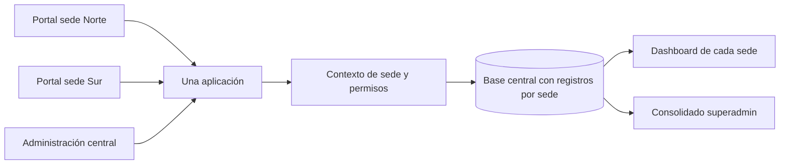

# Plan multisede, visitas y gestión individual de trabajadores

Estado: propuesta para revisión. No se modificaron código de aplicación, dominios, permisos reales ni base de datos al preparar este plan.

> **Lectura histórica:** este plan no describe por completo el estado actual. El CRUD individual y la carga con vista previa de trabajadores ya se implementaron para superadmin; la resolución por dominio, permisos delegados propuestos e identificación nominal de lecturas siguen sin estar implementados. Consultar el [manual técnico vigente](DOCUMENTACION-TECNICA.md) y la [guía de hosting y subdominios](DESPLIEGUE-Y-SUBDOMINIOS.md). El SQL asociado es un borrador y debe revisarse contra el esquema actual antes de usarlo.

## Decisiones confirmadas

- Una plataforma integrada para varias sedes, con acceso público sin cuenta de trabajador y DNI antes del examen.
- Superadmin conserva todas las funciones y la visión consolidada.
- El capacitador podrá **editar trabajadores de su propia sede**, además de importar, cuando superadmin le habilite el permiso correspondiente. Edición e importación pueden habilitarse por separado.
- Todavía no está definido si la evaluación exigirá solo cantidades de vistas o también una lista de personas. Se propone resolver primero la medición por portal/sede, sin presentar visitantes anónimos como trabajadores identificados.

## 1. Arquitectura recomendada

Una aplicación, una base central y un portal por sede. Los subdominios identifican el contexto de la sede; las consultas y permisos del servidor realizan la separación real.

Ejemplos ilustrativos, sujetos al dominio que se elija: `norte.academia.empresa.pe`, `sur.academia.empresa.pe` y `academia.empresa.pe` para selección de sede y administración central. No se configuraron estos nombres.

Una actualización de código se despliega una vez. Cada sede gestiona sus datos permitidos sin mantener copias distintas de la plataforma. La base central evita duplicar una persona cuando cambia de sede. Una base independiente por sede aumentaría el trabajo de traslados, mantenimiento y consolidación sin aportar una necesidad demostrada en este proyecto.

El subdominio se resolverá mediante una lista de dominios registrados; un dominio desconocido no caerá silenciosamente en otra sede. Las rutas públicas, privadas, archivos, cachés, notificaciones y trabajadores usarán ese mismo contexto. Un `site_id` recibido del navegador no podrá sustituirlo. Este enfoque sigue las recomendaciones de aislamiento de [OWASP](https://cheatsheetseries.owasp.org/cheatsheets/Multi_Tenant_Security_Cheat_Sheet.html).

Las sesiones permanecerán limitadas al host. No se compartirá una cookie administrativa entre todos los subdominios sin un diseño explícito de acceso central; [MDN explica el alcance de Domain en cookies](https://developer.mozilla.org/en-US/docs/Web/HTTP/Reference/Headers/Set-Cookie). El panel central ofrecerá al superadmin un selector explícito de sede. No se necesita implementar SSO en la primera versión.

La instalación actual está restringida a localhost (`Require local`). Publicar varios subdominios requiere alojamiento accesible por las sedes, DNS, HTTPS, configuración del servidor, respaldos y pruebas de exposición. Crear DNS por sí solo no hace accesible ni separa la instalación actual.

## 2. Qué se puede demostrar con las visitas

Hoy `ContentViews` incrementa un contador global por capacitación/evento y evita repetirlo dentro de la sesión. Excluye sesiones administrativas. No registra la sede del portal ni la identidad del visitante, y no permite reconstruir un informe histórico por fecha.

| Indicador nuevo | Qué demuestra | Qué no demuestra |
|---|---|---|
| Aperturas por portal de sede y capacitación | Que se abrió el contenido a través de ese portal | Que el visitante trabaja allí, leyó todo o es una persona distinta |
| Sesiones distintas registradas | Navegadores/sesiones según la regla de conteo | Personas únicas; puede haber dispositivos compartidos, cookies borradas o varias sesiones por persona |
| Participantes identificados por DNI | Registros del padrón que iniciaron una evaluación | Lectura individual previa de todo el material |
| Evaluaciones enviadas y notas | Entregas vinculadas a DNI y sede histórica | Asistencia o lectura demostrada solo por haber abierto el material |

Propuesta inicial: registrar una apertura por sesión, sede y capacitación; las recargas y solicitudes duplicadas no suman. Guardar fecha/hora del servidor, curso, portal/sede y clave anónima de deduplicación; mantener fuera del conteo las vistas previas administrativas. No usar IP, geolocalización ni huellas del navegador para intentar identificar personas. La consulta por DNI del examen conserva su función actual.

El dashboard mostrará vistas por capacitación, sede y periodo, participantes identificados y evaluaciones completadas en columnas separadas. Habrá exportación de esos mismos filtros. No llamar «trabajadores que vieron» al conteo anónimo ni sumar las tres métricas como si fueran personas diferentes.

Si una persona entra al subdominio Norte desde otra sede, la apertura corresponde al **portal Norte**, no a una pertenencia laboral comprobada. Una capacitación proyectada ante treinta trabajadores puede generar una sola apertura: la asistencia grupal requeriría un registro distinto si se la exige.

Si después exigen una lista nominal de quienes revisaron materiales, se podrá ofrecer identificación sencilla por DNI antes de abrir el material o una confirmación explícita de revisión. No requiere contraseña, pero sí cambia el momento de identificación. No se activará esa exigencia ahora. Tampoco se atribuirán retrospectivamente todas las visitas anónimas de un dispositivo al último DNI utilizado en él.

Las vistas actuales se conservarán como **histórico global sin atribución de sede visitante ni fecha**. La sede propietaria del curso no permite inferir la sede de cada visitante. La medición nueva comenzará con una fecha de corte visible.

## 3. Separar contenido y administración por sede

Primera versión: cada capacitación conserva su sede responsable actual. Catálogo público, detalle, materiales, evaluación, reportes y contadores respetan el portal seleccionado. Los enlaces a contenido no publicado en ese portal no permiten saltar de sede modificando un ID.

Eventos e imágenes necesitan un alcance explícito: eventos de una sede o comunicados globales administrados por superadmin. Actualmente los eventos son compartidos y carecen de sede/propietario. No se debe asignar a ciegas una sede a sus registros históricos; se revisarán antes del piloto. El slider/popup global puede heredarse inicialmente; la configuración visual por sede es una ampliación posterior.

Para una capacitación común a todas las sedes, se recomienda en una segunda etapa una publicación por sede vinculada a un contenido/versionado común. Cada publicación tendrá seguimiento propio. Antes de implementarla se decidirá si una aprobación es válida en toda la empresa o debe renovarse por sede; de ello depende el límite de intentos. No se copiarán o reiniciarán notas automáticamente por cambiar de portal.

## 4. Edición individual del padrón

Actualmente ya existe «Editar acceso» para administradores/capacitadores, pero el directorio de trabajadores no tiene edición individual. Son funciones distintas: una persona del padrón no necesita convertirse en usuario con contraseña.

La ficha de trabajador incluirá nombre, DNI, cargo, sede actual, estado, fecha de alta/baja, historial de movimientos y evaluaciones accesibles según el rol. Acciones propuestas: crear trabajador, editar datos, inactivar, reactivar, solicitar traslado y ver historial. Búsqueda por DNI/nombre y filtros de sede/estado.

| Acción | Superadmin | Capacitador con permiso |
|---|---|---|
| Ver/editar trabajador | Todas las sedes | Solo sede asignada |
| Crear trabajador | Permitido | Solo su sede; DNI global único |
| Importar CSV/XLSX | Todas las sedes | Solo si se habilita importación para su sede |
| Inactivar/reactivar | Permitido | En su sede, con motivo; si hay acceso administrativo vinculado requiere superadmin |
| Corregir DNI | Procedimiento especial con revisión de duplicados e historial | Solicita corrección |
| Trasladar entre sedes | Autoriza/ejecuta | Solicita; no reasigna personal ajeno |
| Otorgar permisos o cambiar roles | Permitido | Denegado |

Superadmin encontrará dos permisos sencillos en el acceso del capacitador: «Editar trabajadores de su sede» e «Importar trabajadores de su sede». Deshabilitados por defecto. La concesión/revocación queda registrada, se comprueba en API y no se amplía por cambiar de sede.

El DNI será único en toda la empresa. Si ya existe en otra sede, no se crea otra persona ni se reasigna mediante importación: se muestra un conflicto sin revelar el padrón ajeno y se ofrece solicitar traslado. Un identificador interno estable permitirá corregir un DNI sin perder la vinculación con el historial.

Una edición guarda quién, cuándo y qué campos cambió; se registra lo necesario en un historial privado, nunca contraseñas ni archivos completos de importación en logs. Un número de versión del registro evita que dos operadores sobrescriban cambios silenciosamente.

## 5. Traslados, rotación, bajas y reingresos

La persona mantiene una sola identidad. La sede no se trata como un campo que borra el estado anterior, sino como una asignación con inicio y fin.

Ejemplo: una trabajadora completa una evaluación en Norte el 10 de noviembre y pasa a Sur el 15. La evaluación del día 10 sigue atribuida a Norte; desde el traslado, su acceso al examen depende de Sur. El expediente individual reúne ambas etapas. No se duplican personas ni se trasladan sus visitas/notas antiguas a Sur.

Movimientos previstos: traslado permanente, rotación temporal con fecha de regreso, baja y reingreso. No habrá periodos de sede superpuestos para una persona en la primera versión. Los movimientos inmediatos se aplican en una transacción; los programados requieren una tarea del servidor idempotente y supervisada, o mantenerse pendientes hasta confirmación operativa. No basta con guardar una fecha futura sin un mecanismo que la aplique.

Para una rotación temporal, se registra sede de origen, destino, fechas y responsable; al volver, se cierra el periodo temporal y se abre el siguiente. Se conserva toda la cadena. Superadmin resolverá conflictos si cambian las fechas, se cancela la rotación o aparece otro traslado programado.

Si el trabajador también es capacitador, el movimiento debe actualizar coherentemente el padrón, su acceso y la vigencia de sesión. Los permisos especiales no se heredan automáticamente en otra sede: superadmin los confirma. Esto evita el bloqueo circular actual, donde la importación impide cambiar de sede a un capacitador activo y la edición de acceso exige que el trabajador ya pertenezca a la sede nueva.

Baja: inactivar, conservar notas e historial y cerrar/revocar accesos administrativos vinculados mediante superadmin. Reingreso: reactivar la misma persona y abrir un periodo de sede nuevo; no crear otro DNI ni resetear intentos por ese motivo.

Un intento ya comenzado conserva la sede histórica de inicio. Propuesta: permitir que termine dentro de su plazo si el trabajador continúa activo; el siguiente inicio exige su sede vigente. Una baja puede revocar el intento pendiente. Esta regla se probará con traslados concurrentes, sin reescribir envíos completados.

Los reportes necesitan dos filtros diferentes: «sede en la que ocurrió la actividad» y «sede actual del trabajador». Por defecto, los resultados históricos usan la primera. Un capacitador verá historia generada en su sede; superadmin verá el expediente entre sedes. No se mostrará automáticamente a un capacitador el detalle privado de otra sede al recibir un trabajador.

## 6. Carga masiva complementaria

Se conserva CSV/XLSX y se agrega una vista previa con: nuevos, actualizados, sin cambios, duplicados, errores y posibles traslados. Confirmación antes de escribir, resumen final descargable y rechazo de cambios que quedaron desactualizados desde la vista previa.

Para el capacitador autorizado, la sede procede del servidor: un CSV no puede mover personas a otra sede. Los cambios de sede detectados se convierten en solicitudes, no en transferencias ocultas. La importación cotidiana no desactiva a quienes no aparecen en el archivo. Reemplazar un padrón completo será una operación explícita de superadmin con vista previa de bajas.

Hoy una importación actualiza nombre/cargo de matrículas históricas. Se debe separar «dato actual del trabajador» de «dato registrado al evaluar»: nuevas ediciones/importaciones actualizarán el maestro, manteniendo la evidencia de evaluaciones completadas. Datos históricos ya sobrescritos no pueden recuperarse por inferencia; se marcará el alcance de la información disponible.

## 7. Propuesta de datos y migración

El [borrador SQL revisable](multisede/propuesta-esquema.sql) cubre únicamente el primer alcance: dominios, permisos de padrón, identidad estable del trabajador, historial de asignaciones/auditoría, eventos por sede, visitas y sede histórica de matrícula. No se ejecutó. La publicación compartida de una capacitación y la identidad nominal de lectura quedan fuera de ese primer script hasta definir sus reglas.

| Cambio | Justificación | Riesgo/dependencia |
|---|---|---|
| Dominios → sede | Resolver portal desde host registrado | DNS/HTTPS y host validado; rechazar sede inactiva |
| Permisos por cuenta/sede | Autorizar edición/importación sin nuevos roles | Revalidar sesión y revocar al trasladar al capacitador |
| ID interno y versión en employees | Estabilidad frente a corrección de DNI; evitar ediciones perdidas | ALTER y backfill ensayados en copia; conservar PK/FKs actuales de DNI |
| Periodos de sede y movimientos | Rotación e historial | No solapar periodos; coordinar con employees.site_id y accesos |
| Sede/persona en matrícula | Congelar atribución de nuevas evaluaciones | Registros anteriores quedan desconocidos si no hay evidencia fiable |
| Eventos por sede | Separar gestión y catálogo | NULL histórico requiere revisión; global solo superadmin |
| Eventos de visita | Métricas por portal/curso/fecha | Deduplicación, volumen y retención de datos anónimos |

El contador antiguo se conserva; no se distribuirá entre sedes. Se añadirá la información nueva de forma compatible antes de sustituir las lecturas. Las asignaciones iniciales representarán el estado verificado al activar el módulo, no fechas de ingreso inventadas. Los permisos nuevos empiezan apagados.

Antes de aplicar: revisar scripts, respaldo consistente de BD y archivos, verificar restauración en una base aislada, comparar metadatos y contadores, medir bloqueos del ALTER, registrar ventana/fecha de corte. Usar la cuenta CLI de mantenimiento, no dar DDL a la cuenta web. Añadir a la cuenta web únicamente el DML necesario para nuevas tablas.

Reversión preferida: desactivar funciones nuevas por configuración y volver a lecturas compatibles, conservando tablas/columnas y eventos nuevos. No eliminar esas tablas después de que reciban información. Una reversión física necesita respaldo, exportación de actividad nueva y script inverso revisado; el DDL MySQL no se revierte con rollback transaccional. El archivo SQL incluye el inverso comentado exclusivamente para una prueba vacía antes del piloto.

## 8. Orden de implementación y condiciones de salida

| Fase | Entrega | Se considera lista cuando… |
|---|---|---|
| 1. Definiciones y seguridad | Sedes/hosts, permisos, regla de visita y migración ensayada | Existe lista de sedes/operadores; respaldo restaurado; ninguna migración afecta datos reales durante pruebas |
| 2. Padrón individual | Crear/editar/inactivar/reactivar, permisos, importación con vista previa | Capacitador autorizado edita solo su sede; quien no tiene permiso recibe 403; conflictos/duplicados no sobrescriben datos |
| 3. Movilidad e historia | Traslados, rotaciones, baja/reingreso y sede histórica | Ejemplo Norte→Sur conserva notas/atribución; cambio de capacitador es atómico; no hay solapamientos |
| 4. Portales por sede | Host, catálogo, eventos, archivos y caché separados | Dos dominios de prueba no intercambian datos, incluso cambiando IDs, usando caché o reutilizando sesiones |
| 5. Medición y reportes | Vistas nuevas por portal/curso/periodo y dashboard/exportación | Recargas no inflan conteo; totales/exportación coinciden; métricas anónimas e identificadas están separadas |
| 6. Piloto y expansión | Dos sedes inicialmente, luego las demás | Operadores validan edición/importación/traslado; conteos tienen definiciones aceptadas; existe reversión probada |

No se fija una fecha de producción sin conocer dominio, hosting, número de sedes y volumen de trabajadores. La primera entrega útil será la edición individual autorizada; no necesita esperar a comprar/configurar subdominios. Las fases 3–5 deben completarse antes de presentar informes multisede como definitivos.

Pruebas obligatorias: suplantación de host/contexto, acceso directo a archivos ajenos, separación de caché/sesión, CSV con sede ajena, cambios simultáneos, traslado durante intento, DNI duplicado, baja/reingreso, revocación de permiso, rotación con retorno, envío idempotente, corte de métricas antiguas/nuevas y exportación filtrada. Todo con sedes/personas sintéticas.

Pendiente funcional para cerrar más adelante: si la evaluación institucional exige lista nominal de lectura, elegir identificación antes del material o asistencia/confirmación explícita. Hasta entonces, el portal seguirá sin login de trabajador y el DNI se solicitará para el examen.
