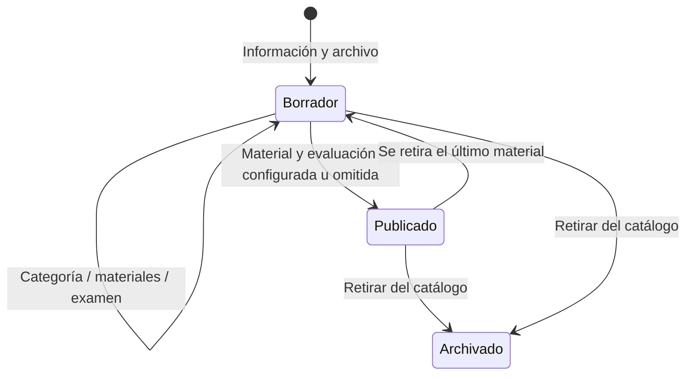

# Procesos y destinos de publicación

## Personas y permisos

| Persona | Acceso |
|---|---|
| Trabajador sin sesión | Inicio, catálogo publicado, materiales públicos, eventos y evaluación |
| Capacitador | Capacitaciones/exámenes/resultados de su sede, eventos y dashboard enfocado en su sede |
| Superadministrador | Todas las funciones y sedes, incluidos colaboradores, accesos, sedes, slider y popup |

La sede relaciona colaboradores, capacitadores y capacitaciones. El trabajador no necesita cuenta; al consultar el DNI, el servidor valida que esté activo y que pertenezca a la sede de la capacitación.

## 1. Iniciar sesión

1. El navegador obtiene `/api/v1/session`, la cookie y el CSRF.
2. El formulario envía correo y contraseña por POST con el encabezado CSRF.
3. El servidor comprueba usuario activo y hash. Regenera el ID de sesión y el CSRF.
4. La identidad se vuelve a consultar en la BD en las peticiones protegidas: cambios de rol, desactivaciones y cambios de contraseña tienen efecto.
5. La sesión vence tras una hora de inactividad. La campana solo se monta si hay identidad autenticada.
6. Al cerrar sesión se limpia la vista privada y se abre Inicio del portal. Cada login correcto abre Inicio del panel (`#admin`), sin restaurar la sección de la cuenta anterior. Una ruta de Usuarios/Sedes sin permiso vuelve al Inicio del panel antes de solicitar datos restringidos.
7. En desarrollo, 127.0.0.1 y ::1 no tienen bloqueo de intentos. Las demás direcciones conservan el límite. Apache restringe esta instalación al equipo local.

Las credenciales existentes se copian; no se inventan cuentas ni se restablecen contraseñas durante el cambio de nombre. El usuario administrador creado anteriormente con contraseña corta se conserva como excepción histórica. El formulario para nuevas contraseñas sigue exigiendo 12 caracteres y un máximo de 72 bytes.

## 2. Colaboradores, accesos y sedes

1. Superadministración crea una sede con nombre único.
2. Importa colaboradores desde CSV/XLSX con DNI, nombre completo, cargo y sede. Si el archivo no incluye sede, utiliza la elegida en el formulario.
3. Crea el acceso Capacitador seleccionando un colaborador activo; nombre, cargo y sede proceden de la base maestra.
4. Un capacitador necesita sede activa; para un superadministrador es opcional.
5. Una sede con colaboradores o accesos activos no puede desactivarse hasta reasignarlos o desactivarlos.
6. El propio superadministrador no puede quitarse el rol ni desactivar su acceso. Debe quedar un superadministrador activo.
7. Desactivar un usuario o cambiar su contraseña incrementa su versión de autenticación y revoca las sesiones anteriores.

## 3. Capacitación

El primer formulario reúne título, categoría, sede responsable, descripción y PDF/PPT/PPTX. Para un capacitador la sede procede de su acceso; el superadministrador la selecciona. La capacitación conserva sede, creador y nombre del creador. No pide duración ni acepta video. Si falla el archivo inicial, se revierte el curso. Los archivos se guardan fuera del directorio público y se sirven desde la API.

Publicar requiere material y, salvo que se marque «Capacitación sin examen», un examen con al menos una pregunta. En el catálogo solo aparecen cursos publicados. Inicio muestra las seis capacitaciones publicadas más recientes por fecha de creación. El archivado retira el curso sin borrar las notas históricas.

PDF usa el visor del navegador. PPT/PPTX se convierten localmente a PDF para conservar su diseño estático, con descarga del original. Las portadas muestran la primera página del material seleccionado. No se reproducen animaciones ni multimedia incrustada. Ver [materiales y portadas](MATERIALES.md).

## 4. Cuestionario

Cada examen tiene una o más preguntas, tres alternativas distintas y una respuesta correcta por pregunta. El editor comienza con una y permite agregar/quitar. La nota es `aciertos × 20 / cantidad de preguntas`, redondeada a dos decimales; los exámenes existentes de diez preguntas conservan su calificación. Los enunciados no se repiten. La explicación es opcional. Modificar preguntas genera una versión nueva; guardar sin cambios conserva la versión. Las notas anteriores continúan vinculadas a la versión respondida.

Al crear o guardar el examen se exige fecha/hora de apertura, duración por intento (1–1440 minutos), máximo de intentos (1–10) y nota mínima aprobatoria (entero de 1–20). Cambiar los criterios crea una versión nueva y conserva el historial anterior. La fecha de cierre es opcional. El tiempo vence al terminar la duración o llegar el cierre, lo que ocurra primero. Sin cierre, sigue habilitado hasta desactivarlo manualmente. El botón de disponibilidad conserva la edición de preguntas sin guardar y afecta todas las versiones: bloquea nuevos inicios y envíos pendientes, sin borrar resultados. Reactivar no reinicia plazos y respeta las fechas. Cambiar solo horario/duración conserva versión y resultados; afecta el cálculo de intentos pendientes. Los exámenes heredados mantienen sus fechas/duración existentes hasta que se editen; no se asignan plazos retroactivos durante la migración.

El panel de capacitaciones muestra tarjetas con portada, estado de publicación, materiales y disponibilidad del examen. Buscar o filtrar se realiza localmente. El editor reúne horario, duración y enlaces al examen y sus resultados.

## 5. Evaluación del trabajador

1. Elige un curso publicado y revisa los materiales.
2. Abre «Empezar evaluación» e ingresa únicamente su DNI de ocho dígitos dentro de una ventana modal.
3. El sistema consulta la base activa de colaboradores y muestra nombre completo y cargo para confirmación. Un DNI inexistente o inactivo no puede iniciar.
4. Al confirmar, el servidor exige la consulta previa del mismo DNI y curso en esta sesión (vigencia de 15 minutos), vuelve a validar padrón activo y sede coincidente, registra nombre/cargo y obtiene un token aleatorio para el intento. En la BD se guarda solo su hash.
5. El cliente recibe preguntas y alternativas, nunca las respuestas correctas antes de enviar.
6. Responde una pregunta a la vez, con navegación por número, progreso y reloj. Revisa sus respuestas antes de enviarlas. La nota se calcula sobre 20. La evaluación se muestra en una ventana independiente del visor del material.
7. El servidor registra el intento terminado. Un reenvío del mismo token devuelve la nota ya guardada.
8. El creador elige de 1 a 10 intentos enviados por DNI y versión. Solo se permite otro envío con menos del 90 % de aciertos y cupo disponible; llegar a 90 % o más bloquea reintentos. No se suman las notas. Crear una versión nueva abre su propio límite.
9. El alumno recibe su nota, aciertos y estado aprobado/no aprobado según el mínimo de su versión. El reporte administrativo y Excel incluyen también el límite de intentos y la nota mínima. Las versiones anteriores sin mínimo se identifican explícitamente.

Cerrar la ventana vuelve al material y conserva respuestas mientras la página del curso permanezca montada; el reloj sigue corriendo. Cambiar de página o recargar pierde ese estado local. Los datos personales y el token no se guardan en localStorage. El servidor controla el plazo y no hay envío automático al vencer. Un error de red al enviar permite comprobar el envío repitiendo el mismo token y respuestas, sin duplicar la nota.

Un intento pendiente no consume una oportunidad; empezar otra vez reemplaza el pendiente. El DNI debe existir en el maestro, pero escribirlo no constituye una autenticación fuerte de la persona. No hay certificados ni encuesta final implementados en esta versión.

## 6. Eventos y galería

El administrador registra nombre, categoría, lugar, fecha/hora Lima y descripción. Puede guardar un borrador con menos imágenes. Para publicar necesita entre tres y doce imágenes distintas, JPG/PNG/WEBP, máximo 8 MB cada una. La primera es la portada y puede cambiarse.

El evento aparece en **Eventos**, no como listado completo en Inicio. La portada abre una galería con flechas, miniaturas, Escape y navegación por teclado. Las imágenes de borradores no son públicas. Los eventos antiguos migrados conservan su estado; si se editan y vuelven a publicar deben cumplir el mínimo actual.

## 7. Slider y actividad

- El slider de Inicio descubre las imágenes de `public/assets/slider/` al abrir o recargar Inicio. Avanza cada seis segundos con más de una imagen; pausa con foco de teclado y pestaña oculta. No muestra contador ni botón de reproducción. Sus recursos son estáticos, independientes de eventos y base de datos.
- La campana obtiene cambios desde `activity_log`; al pulsar una notificación abre su destino y la marca como leída en ese navegador. No existe gestión manual de Avisos. Ver [actividad](ACTIVIDAD.md).
- Los eventos se muestran en su catálogo y visor, sin comentarios ni contadores de fotos.
- La tabla histórica `announcements` se conserva por integridad de referencias; las rutas administrativas heredadas devuelven 410 y la ruta pública devuelve una lista vacía.

## Mapa de publicación

| Se crea en | Destino del trabajador | Condición |
|---|---|---|
| Capacitaciones | Catálogo y vista de material | Estado publicado |
| Últimos cursos publicados | Tres tarjetas en Inicio | Orden por creación descendente |
| Imágenes copiadas a `public/assets/slider/` | Slider de Inicio | JPG/PNG/WebP válidos, orden por nombre |
| Eventos | Catálogo de Eventos | Activo |
| Categorías | Selectores y filtros | Categoría registrada |
| Exámenes | Botón Empezar evaluación | Curso publicado con examen |
| Resultados | Solo administración | Intento completado |
| Usuarios y sedes | Solo superadministración | Permiso verificado por servidor |

## Visitas y eventos del panel

Eventos administrativos en tarjetas de tres columnas, dos en pantallas medianas y una en móvil. Las capacitaciones muestran vistas en las tarjetas públicas, junto al visor y en el panel. Los eventos conservan sus visitas solo en el panel. En cursos, el registro comienza al cargar el material en el visor o solicitar el original; ver la portada o una página sin material no suma. El contador representa aperturas públicas por sesión; no identifica personas ni prueba que hayan leído todo el contenido. Recargar/reabrir en la misma sesión no aumenta el total. Las revisiones de administradores no se cuentan. Las visitas comienzan desde esta implementación.

Los botones de acción comparten geometría y tipografía, con colores según la acción. El cierre de formularios usa un SVG centrado y un área circular de 44 px; el contenido reserva espacio superior para evitar superposición.

## Preparación de capacitación y cambio de resultados — 23 de octubre de 2026

El editor muestra una línea de cuatro pasos: Información, Material, Evaluación y Publicación. La opción «Capacitación sin examen» omite el requisito de evaluación; en el portal solo aparece el material. Si ya existían preguntas y notas se conservan para consulta/exportación. No se admiten nuevos intentos ni envíos pendientes mientras el curso esté en ese modo; los tokens ya completados siguen devolviendo su nota. Volver a exigir un examen sin tenerlo creado pasa un curso publicado a borrador; si el examen existe, conserva publicación y sus fechas/estado.

«Guardar cambios» permanece deshabilitado hasta modificar título, categoría, descripción o modo de examen. Comparación con el estado guardado normalizando espacios de los extremos, igual que el backend. Deshacer las modificaciones vuelve a deshabilitarlo. Guardar sin cambios tampoco genera actividad en el servidor. La portada requiere una selección diferente para habilitar su botón. Publicación se bloquea mientras existan cambios sin guardar o falte material/evaluación requerida.

En Resultados, elegir examen actualiza solo la tabla y la dirección de la página, preservando el selector y evitando el salto al inicio. El área de resultados tiene altura estable y desplazamiento propio. Transición de opacidad de 180 ms, omitida con movimiento reducido. Durante la carga se indica actividad y se bloquea exportación; respuestas antiguas se descartan si se cambia rápido de examen. Exportación siempre corresponde a la selección que terminó de cargar. Exportar y Actualizar se alinean al selector, con distribución adaptable en móvil.

## Guardar examen y publicar — 26 de octubre de 2026

Guardar un examen correctamente abre `#admin/capacitaciones/{id}/publicar`, que reutiliza el editor y su botón de publicación. No publica automáticamente. Al pulsar **Publicar** se guardan primero los cambios pendientes; únicamente si la publicación termina correctamente vuelve al listado `#admin/capacitaciones` con una confirmación destacada y cerrable. Un error mantiene el formulario disponible para corregir o reintentar.

Cada nueva versión de examen guarda `created_by` y una copia `creator_name` del usuario autenticado. El cuerpo de la petición no puede atribuir otro autor. Guardar sin cambiar preguntas o modificar solo el periodo conserva la versión y el autor. El editor muestra el nombre y la fecha; versiones antiguas sin registro muestran «Sin registro de autor (examen anterior)».

Las cards públicas y administrativas priorizan categoría y título. La descripción se muestra únicamente en el detalle. El selector de imágenes de eventos presenta la imagen completa con `object-fit: contain`, sin recortar ni deformar.

Revisión de permisos e identificación: [correcciones de gravedad alta](CORRECCIONES-ALTAS-2026-10-28.md). El capacitador ve estadísticas de sus capacitaciones, borradores, participación y evaluaciones; la visión global del dashboard corresponde al superadmin.

El detalle público del curso muestra Activo, Próximamente, Inactivo o Finalizado. Solo añade la fecha/hora de cierre cuando está activo y hay cierre definido; no muestra la apertura. El editor administrativo conserva los campos de programación.
